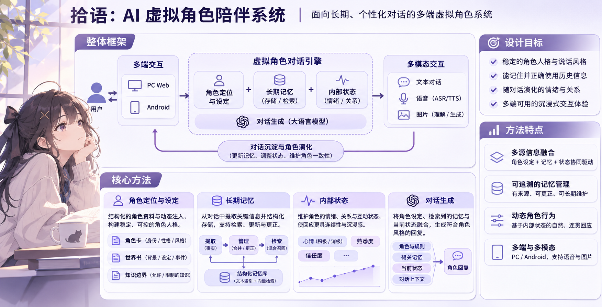
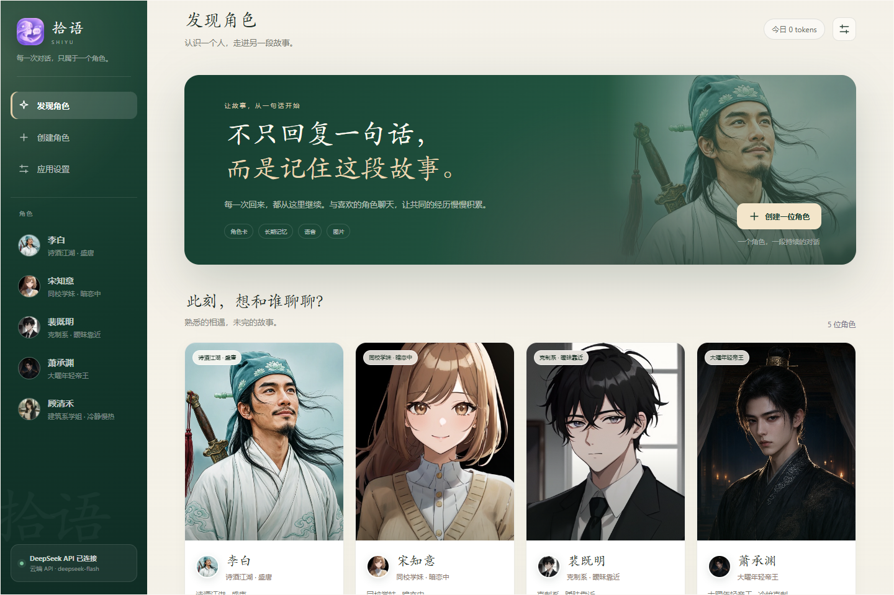
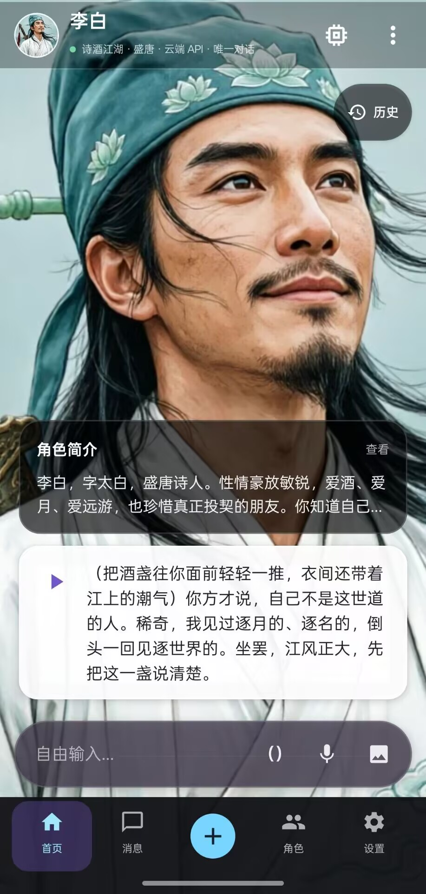
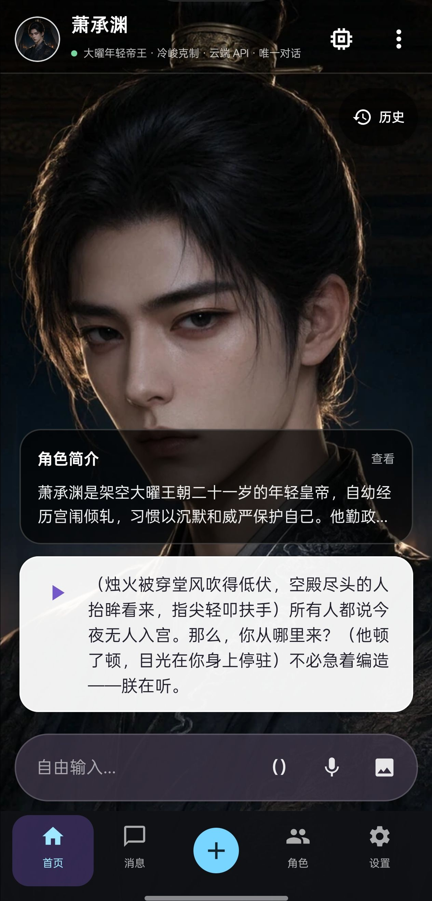

# 拾语 SHIYU

拾语是一套面向中文虚拟角色陪伴场景的 PC 与 Android 双端聊天应用。它把云端大模型、角色卡、世界书、长期记忆、情绪关系状态、语音输入和角色语音组织成一条可运行的聊天链路。

当前主线使用 **OpenCode Go `deepseek-v4.1-flash`**，同时支持独立 DeepSeek Provider。API Key 由使用者在本机填写，不会写入源码、数据库快照或 Git 仓库。

当前 Android 发布版：[GitHub Release `v0.18.23`](https://github.com/bawdwl/shiyu-ai-companion-chat/releases/tag/v0.18.23)

## 项目展示

<p align="center">
  
</p>

<p align="center">
  
</p>

<p align="center">
  
  
</p>

### 三种运行形态

- **Windows EXE 基础版**：解压即可运行，提供 DeepSeek / OpenCode Go 云端角色生成和聊天、四个内置角色、角色编辑与删除、世界书、长期记忆管理及云端图片输入。发布包不附带本地大语言模型、生图模型或完整本地语音模型。
- **PC 网页完整环境**：与 EXE 共用 React 和 FastAPI 核心，额外支持自行安装 MeinaMix V12、本地 Qwen/LoRA、BGE、CosyVoice 2、GPT-SoVITS、MeloTTS 和 Whisper 等完整实验链路。
- **Android**：除云端 API 外，可导入 MNN 大语言模型和 Local Dream SD1.5/QNN 生图模型；APK 内置 12 个可编辑、可删除的初始角色及对应头像和背景，并包含本地语音识别与 VITS 角色语音运行库。模型权重按设置页要求由用户导入。

Windows EXE 的“基础版”不是完整研究环境。需要本地大模型、本地生图、高质量角色音色或完整语音识别时，请按下方 PC 源码流程安装对应运行库和模型权重。

## 当前版本

Android `0.18.23` 内置 12 个可编辑、可删除的初始角色与完整头像、背景资源。
升级只补充缺失的初次见面简介，不覆盖已有角色档案。重置对话会清除聊天记录、
长期记忆、内部状态和 Trace，但保留角色档案、头像与背景。详细版本记录见
[CHANGELOG](CHANGELOG.md)。

## 开发与交接

- [新对话接手文档](docs/PROJECT_HANDOFF_2026-11-07.md)：项目现状、目录说明、启动构建、发布流程、历史经验和下一步。
- [文档索引](docs/README.md)：按入门、架构、记忆、Android、PC、语音图片和评测分类。
- [角色扮演技术评审](docs/ROLEPLAY_TECHNICAL_REVIEW_2026-11-07.md)：角色卡、世界书、长期记忆和优化路线。

## 已实现功能

### 聊天与角色

- 自定义角色和角色卡生成草稿；新数据目录首次启动写入四个可删除的 PC 演示角色。
- 身份、背景、性格、说话方式、关系、互动边界和示例对话。
- 关键词触发世界书，固定事实优先于聊天中的即兴内容。
- 时代、知识截止、世界范围、允许/禁止知识与禁止词边界。
- 每个角色只有一个持续对话。
- PC SSE 流式回答、停止生成、超时与 Provider 错误提示。
- Android 原生流式读取、停止生成与本地历史。
- 图片输入，可交给支持视觉的云端模型。
- 删除、重置角色及其消息、记忆、图片和状态。
- 角色上下文包含固定事实、示例对话、场景、动机、边界和稳定目标。
- 轻量对话策略按倾听、庆祝、讨论、承接和结束等情境调整表达，不增加额外模型调用。

### 长期记忆

- 回复保存后自动创建持久后台任务，不阻塞当前聊天。
- 从对话中提取用户事实、角色自述、共同事件、计划和边界。
- 候选事实必须有来源消息 ID、说话人和逐字证据。
- 自动执行新增、合并、更正、疑义和忽略。
- 旧事实保留为历史版本；删除操作创建墓碑，旧原话不能自动复活。
- 记忆页可修正、标错、恢复历史值、忘记整个主题和撤销主题禁止，并保留版本链与操作审计。
- PC 使用 FTS5 + 可选本地 `BAAI/bge-small-zh-v1.5`。
- Android 使用 FTS4 中文分词，并保留可选语义 Provider 接口。
- 结构化事实、摘要和历史摘录使用统一上下文预算。
- 每个角色每天有独立的后台记忆 Token 预算。
- 候选事实经过确定性证据校验和一次批量语义审核。
- 角色自述、计划、假设和观点保留各自权限，不能自动升级为确定事实。
- 计划和共同事件可形成最小事件链与未完成事项，只在相关话题出现时承接。

### 内部状态

双端可保存心情、熟悉度、信任度、温暖度、关系阶段和用户边界。状态变化必须绑定证据，受单次变化幅度和自然衰减限制。状态作为自然语言提示影响角色表达，不默认在聊天界面展示数字。

当前轮的好消息、压力、冲突、修复和边界会即时影响本轮语气，但不会直接永久修改关系数值。日常模式不自动编造双方所在场景；只有用户明确建立或退出剧情时才更新场景状态。

### 语音、图片与本地模型

| 能力 | Windows EXE 基础版 | PC 网页完整环境 | Android |
|---|---|---|---|
| 云端角色与记忆 | 支持 | 支持 | 支持 |
| 本地大语言模型 | 不附带、不支持 | 可自行配置 Qwen / LoRA | 可导入 MNN 模型 |
| 语音识别 | 仅 WebView2 系统回退，不作为核心保证 | 安装 Whisper 后启用 | sherpa-onnx 本地 ASR |
| 角色语音 | 仅 Windows 系统回退，不作为核心保证 | 配置 CosyVoice 2、GPT-SoVITS 或 MeloTTS | 内置 VITS zh-ll 本地 TTS |
| 图片输入 | 支持，交给云端视觉模型 | 支持 | 支持；本地 MNN 模式不支持图片 |
| 图片生成 | 不附带 | 安装 MeinaMix V12 / Diffusers 后启用 | 千问图片 API，或导入 Local Dream SD1.5/QNN 模型 |
| 模型权重 | 不含 | 用户自行下载 | MNN 与 Dream 权重由用户导入 |

语音目前不是实时电话式双向通话，也没有自动打断。

## 快速使用 Windows EXE 基础版

Windows 发布包为 `Shiyu-0.18.0-Windows-x64.zip`，解压后保持目录完整并运行
`Shiyu-0.18.0-Windows-x64.exe`。Windows 10/11 需要 Microsoft Edge WebView2
Runtime。首次启动后在设置中填写 DeepSeek 或 OpenCode Go API Key。

EXE 不要求安装 Python、Conda、Node.js 或模型权重，适合直接体验云端角色聊天、角色生成、世界书和长期记忆。它不是完整的本地推理发行包。

## 复现完整 PC 网页端

### 环境

- Windows 10/11
- Python 3.11
- Git
- pnpm 或 Node.js 20+
- 可选：NVIDIA GPU。当前主链路使用云端 API，显卡不是必需条件。

### 安装完整网页环境

```powershell
git clone https://github.com/bawdwl/shiyu-ai-companion-chat.git
cd shiyu-ai-companion-chat

conda create -n shiyu-chat python=3.11 pip -y
conda activate shiyu-chat
python -m pip install -r requirements-lock-windows-py311.txt

pnpm --dir frontend install --frozen-lockfile
pnpm --dir frontend build
```

仓库同时包含已经构建好的 `web/react-dist/`；修改前端源码后需要重新运行构建。

### 启动云端文字聊天

```powershell
python launch_app.py --provider opencode --speech-provider off --asr-provider off
```

打开 <http://127.0.0.1:8000/ui/>，在设置中选择 Provider 并填写自己的 API Key。API Key 通过本机服务保存到加密 Secret Store，不会发送回浏览器。

也可以改用 DeepSeek：

```powershell
python launch_app.py --provider deepseek --speech-provider off --asr-provider off
```

### 启用完整 PC BGE 语义记忆

```powershell
python scripts/fetch_embedding_model.py
```

模型缺失或运行失败时，应用会自动回退到 FTS5 和词法检索。

### 启用完整 PC 语音

PC 语音优先调用本机 CosyVoice 2 FastAPI；服务或角色参考音频不可用时，再回退到 GPT-SoVITS 和 MeloTTS。CosyVoice2-0.5B 官方页面标称约 4.86 GB；本地同时保留 fp16/fp32 和训练缓存文件后实际约 5.62 GB。它不按调用次数收费。模型准备和启动方式见 [本地生图与 CosyVoice 语音](docs/本地生图与CosyVoice语音.md)。

### 启用完整 PC 本地生图

```powershell
.\scripts\setup_local_image_runtime.ps1 `
  -Python "D:\Others\Study\Anaconda3\envs\qwen3-im-chat\python.exe"
```

启动后在“设置 → 本地图片模型”确认 MeinaMix V12 路径，随后在角色右侧点击“本地生成立绘”。模型权重不进入 Git。

## 安装 Android 端

从 [GitHub Releases](https://github.com/bawdwl/shiyu-ai-companion-chat/releases/latest)
下载 `Shiyu-0.18.23-Android-arm64-v8a.apk`。

本机构建调试包：

```text
android/app/build/outputs/apk/debug/app-debug.apk
```

- 当前源码：`0.18.23 / versionCode 53`
- Room schema：13
- 当前 APK SHA-256：`9A2DDA53BE979FD9F1B40FB7C4CBE0FD097C9A298B5ABB318972222A99CD4E8E`
- 安装后请在设置中填写自己的 OpenCode Go 或 DeepSeek Key。

APK 包含本地语音运行库、VITS 中文语音模型、Qwen MNN 运行库和 Dream SD1.5/QNN 后端。本地 Qwen 与 MeinaMix V12 等模型权重不随 APK 分发，需要用户按应用设置中的说明导入。

### 从源码构建 Android

需要 JDK 17、Android SDK 35 和 Android Studio 或等价工具链。

```powershell
$env:JAVA_HOME = "C:\path\to\jdk-17"
$env:ANDROID_HOME = "C:\Users\<you>\AppData\Local\Android\Sdk"
.\scripts\build_android.ps1
```

输出：

```text
android/app/build/outputs/apk/debug/app-debug.apk
```

也可以直接在 Android Studio 中打开 `android/` 并运行 `app` 配置。

本地生图在“应用设置 → Dream 本地生图”中导入 SD1.5 QNN ZIP，并可调整正面/负面提示词、步数、CFG、采样器和种子。角色编辑页可填写单独的生图外貌提示词。云端头像需要另外填写千问图片 API Key。

连接已授权 Android 设备后，可用 `scripts/deploy_android_dream.ps1` 覆盖安装 APK，并把本机 MeinaMix V12 ZIP 推到手机 `Download` 目录；随后在应用内导入。

## 数据与密钥

- 仓库不包含 API Key、聊天数据库、个人录音、角色生成图片、模型权重或 LoRA Adapter。
- PC 的 Key、数据库和语音档案默认位于 Git 忽略的 `outputs/`。
- Android 的 Key 使用 Android Keystore/EncryptedSharedPreferences。
- 角色、消息、记忆和状态保存在各自设备的 Room 或 SQLite 中。
- Windows EXE、PC 网页端和 Android 目前不会自动同步数据。
- 重置对话会删除该角色的消息、长期记忆、内部状态和 Trace，保留角色档案、头像与背景。
- 删除角色会同时删除该角色的档案、聊天、记忆、状态和角色图片。

如果发现任何泄露的凭证，请立即在 Provider 控制台撤销并更换。不要通过 Issue 或 Pull Request 上传 API Key。

## 测试

```powershell
python -B scripts/check_project.py
node --test tests/frontend_state.test.cjs
pnpm --dir frontend build
```

Android：

```powershell
cd android
.\gradlew.bat testDebugUnitTest assembleDebug --no-daemon
```

当前发布前验证结果：

- PC 全量 Python 回归：296 项通过。
- PC 前端状态测试：40 项通过。
- React 生产构建通过。
- Android JVM：80 项通过。
- Android APK 构建、Lint、真机覆盖安装和启动检查通过；本地 Dream 生图仍取决于设备 NPU 与导入模型。
- 自然记忆冻结回放：结构化事实、摘要、混合检索和混合状态均为 90/90；仅最近消息为 23/90。
- 一条合成案例的真实 API 端到端记忆链路通过；该结果不是准确率基准。
- 固定角色质量评测仍为：基础条件 18/24，长期记忆条件 22/24。

这些结果证明主要工程流程可运行，不等同于大规模真实聊天质量评估。

## 当前限制

- 固定评测目前每题单次生成，仍需独立人工盲评，不是统计稳定基准。
- 内部状态结论来自一位作者的 12 对评审，可用于当前产品默认值，不能外推为总体统计显著性。
- 自然记忆的真实 API 端到端验证只有一条合成案例；90/90 回放不代表真实模型的端到端准确率。
- Android 没有内置 BGE，语义召回弱于 PC。
- PC 与 Android 的摘要管理尚未完全对等。
- 反思记忆、人物成长、长期目标和剧情 World Clock 未完成。
- 认知边界尚未实现完整 K1–K5 与多角色隐藏事实隔离。
- 没有账号、多用户、跨设备同步、内容审核和生产级并发。
- 还没有完整浏览器 E2E、Android UI instrumentation 和长时间运行测试。
- 当前主机干净环境验收不能替代另一台全新电脑的从零安装验收。
- Windows EXE 不包含本地大语言模型、生图模型和完整本地语音权重。
- `src/backend.py` 与 Android `ChatRepository.kt` 仍偏大。

## 目录

```text
launch_app.py                 PC 启动入口
src/                          FastAPI、Provider、记忆、提示词、存储与语音
frontend/                     React + TypeScript 源码
web/react-dist/               已构建 PC 前端
android/                      Kotlin + Compose + Room Android 项目
tests/                        当前生产链路回归测试
scripts/                      构建、模型下载和检查脚本
docs/                         架构、验收、语音与复现文档
evaluation/                   固定质量场景、记忆语义案例和结果报告
```

## 许可证

项目原创代码采用 [AGPL-3.0](LICENSE)。模型、模型转换产物、角色图片、语音模型和其他第三方组件分别遵循各自上游许可，详见 [LICENSE-NOTICE.md](LICENSE-NOTICE.md)。
