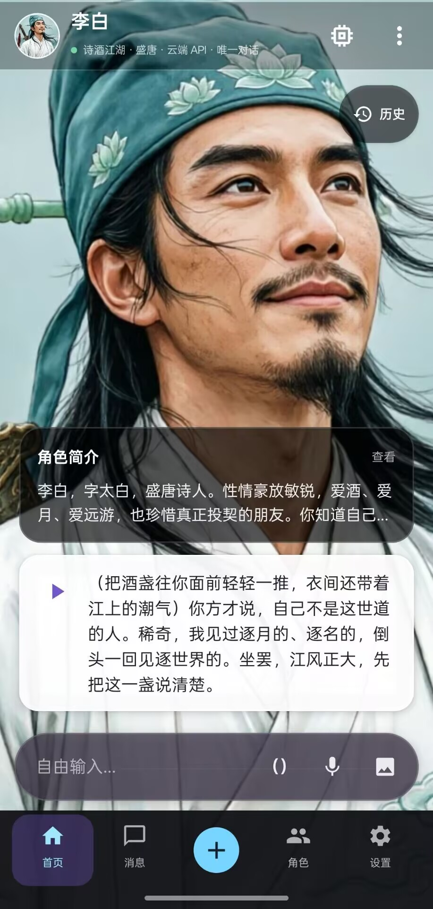

# 拾语 Android 安装与演示

Android 客户端使用 Kotlin、Jetpack Compose、Room、WorkManager 和
Android Keystore 实现。云端模式直接调用所选大模型 API，不要求手机与电脑处于
同一网络。

## 安装

从
[GitHub Releases](https://github.com/bawdwl/shiyu-ai-companion-chat/releases)
下载最新 APK。当前公开版为 `0.18.23`。

安装后进入设置，在“对话与模型”中填写 DeepSeek API Key 或 OpenCode Go API
Key（测试入口）。

应用首次安装会显示 12 个可编辑、可删除的初始角色，每个角色都带有头像和聊天
背景。升级只补充空白角色的初次见面简介，不覆盖已有角色档案。

## 文字对话

1. 在主界面选择角色。
2. 输入消息并发送。
3. 回答流式显示，可以停止生成。
4. 每个角色只有一个持续对话；重置会清除聊天、记忆、内部状态和 Trace，但保留
   角色档案、头像与背景。

## 语音

语音输入使用 sherpa-onnx 本地识别。回复下方点击播放即可调用本地 VITS 语音。
音色按角色保存。当前是“录音识别 → 发送 → 回复后播放”，不是实时双向通话。

## 图片

设置页分成“对话与模型”和“图片生成”。图片部分支持：

- 千问图片 API；
- 导入 Local Dream 兼容的 SD1.5 QNN 模型；
- 设置正面/负面提示词、步数、CFG、采样器和种子；
- 在角色详情页从相册导入头像。

内置应用不分发模型权重。模型需要用户自行导入或按应用提示下载，并分别遵守
模型和运行时许可。

## 本地 MNN 模型

应用可导入 MNN Chat 兼容 ZIP。模型通常至少需要 `config.json`、`llm.mnn`、
`llm.mnn.weight` 和 `tokenizer.mtok`。没有本地模型时继续使用云端 API 即可。
本地 MNN 模式只处理文字，图片输入需要切换回云端视觉模型。

## 演示建议

1. 展示角色首页、上下切换角色和角色自我介绍。
2. 新建一个角色并设置知识边界。
3. 进行多轮对话，指出近期上下文与长期记忆。
4. 查看记忆记录，标记一条错误并继续聊天。
5. 展示语音输入与角色朗读。
6. 展示头像导入或本地生图入口。
7. 说明 Android 与 PC 的推理链路、数据边界和已知限制。
