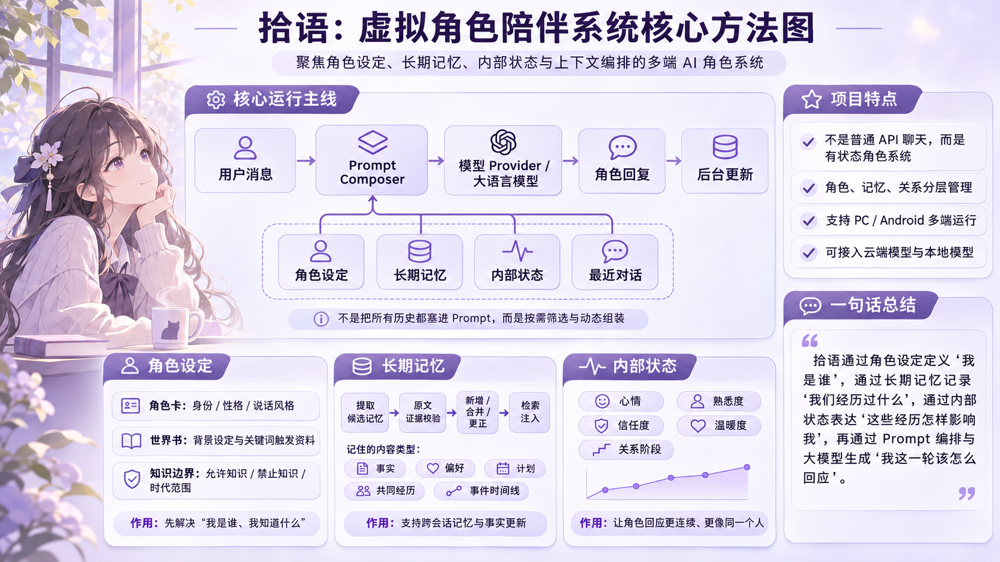

# 拾语（Shiyu）：项目技术架构与运行原理详解

> 一个面向中文虚拟角色陪伴的多端、有状态大模型应用。本文解释项目从角色创建、Prompt 编排、模型调用，到长期记忆、内部状态和多端部署的实际工作流程。
>
> **本文代码核对基准：** 2026-11-11 的 `shiyu-ai-companion-chat-final` 项目源码，对应 Android `v0.19.0`。核对范围同时包含 PC Python 源码和 Android Kotlin 源码，覆盖完整版与云端精简版。本文中的人物与聊天内容均为演示示例，不是用户真实聊天记录。

<p align="center">
  
</p>

## 1. 项目定位：我们要解决什么问题？

如果只有一个普通聊天界面，直接向大模型发送：

```json
[
  {"role": "system", "content": "你叫小满，在书店工作，性格温柔。"},
  {"role": "user", "content": "今天面试完了。"}
]
```

模型可以暂时扮演“小满”，却很容易遇到长期问题：人物设定前后不一致、过往经历丢失、把猜测当事实、每轮采用固定客服话术、关系无法根据互动逐渐变化。拾语不是重新训练云端模型，而是围绕模型构建一套由应用控制的角色运行系统：

- **角色卡和固定事实**决定“这个人是谁”。
- **世界书与认知边界**决定“人物世界是什么、她知道什么、哪些内容不能擅自确认”。
- **原始消息与长期记忆**决定“用户与角色之前说过、经历过什么”。
- **事件时间线与内部状态**决定“事情发展到哪一步、经历如何影响当前情绪和关系”。
- **Prompt Composer**在每轮只选择必要信息，并把它们整理成适合模型生成的上下文。
- **Provider**屏蔽 OpenCode、DeepSeek、本地 Qwen/MNN 的接口差异。
- **持久化存储与后台任务**保证消息、记忆和状态在应用重启后仍可读取，失败时可以重试。

**一句话定位：** 拾语是一套把大模型的单次语言生成能力，组织成“有持续身份、可追溯记忆和人物状态”的中文虚拟角色陪伴系统。

这是一项**应用与系统工程**，不是宣称模型具有意识、真实情感，也不是宣称已解决任意开放式对话中的长期人格一致性。

## 2. 产品形态和技术栈

| 运行形态 | 前端 | 应用逻辑/网络 | 存储与后台 | 特点 |
|---|---|---|---|---|
| PC 网页完整环境 | React、TypeScript | FastAPI、Python，Provider 接入 | SQLite、FTS5、可选 BGE、持久 Worker | 云端聊天及本地研究环境 |
| Windows EXE 基础版 | React 页面 + WebView2 | 本地打包的 FastAPI/Python | SQLite | 免去普通用户手动配置 Python 服务，**不附带**完整本地模型权重与语音、生图研究环境 |
| Android 完整版 | Kotlin、Jetpack Compose、OkHttp | 云端 API 直连或导入 MNN 模型 | Room/SQLite、FTS4、WorkManager | 手机独立运行，同时支持云端、本地模型、语音与 Local Dream |
| Android 云端版 | Kotlin、Jetpack Compose、OkHttp | 云端 API 直连 | Room/SQLite、FTS4、WorkManager | 独立包名，可与完整版共存；不打包 MNN、QNN、ASR、TTS 与 Local Dream |

**模型能力**：OpenCode Go `deepseek-v4.1-flash`、DeepSeek 官方 `deepseek-chat`，以及配置好的 PC Qwen/LoRA 和 Android MNN 模型。不同运行环境的可用模型、语音与图片能力并不完全一致。

**语音/图片**：PC 可选 Whisper、CosyVoice 2、GPT-SoVITS、MeloTTS 与本地生图运行库；Android 完整版使用 sherpa-onnx、VITS，并提供云端图片与可导入的 Local Dream/QNN 途径；Android 云端版只保留云端图片输入与千问生图。现阶段不是具备自动打断的实时电话式语音系统。

**为什么多个运行形态使用不同实现？** PC 借助 Python 方便集成大模型与记忆处理，Android 需要在没有电脑参与的情况下独立工作，因此以 Kotlin/Room 实现相似的业务职责。好处是设备独立，代价是跨端语义一致性、版本迁移与测试需要双份维护。

## 3. 完整聊天生命周期

下面以 Android 云端对话为主线。PC 的职责划分相同，主要区别是 Android 直接通过
HTTPS 请求 DeepSeek 或 OpenCode，而 PC 通过 FastAPI 路由到对应 Provider。

1. **Android 收到用户输入**

   Compose 聊天界面立即更新发送状态，`ChatRepository` 找到该角色唯一的持续会话，
   并确定本轮要使用的模型来源。

2. **读取角色与模型配置**

   读取角色卡、固定 Prompt、当前 Provider、生成参数和已有关系状态。云端角色使用
   普通角色上下文；宋知意、裴既明等固定训练角色继续走与训练一致的精简 Prompt。

3. **解析本轮意图与场景**

   判断用户是在要求回忆、倾诉、庆祝、讨论、承接话题还是结束聊天，同时确认当前
   属于日常交流还是用户明确建立的沉浸剧情。该步骤主要由规则完成，不额外调用模型。

4. **检索世界书与长期记忆**

   世界书根据最近消息和当前输入的关键词按需命中，不整本常驻。记忆系统再根据当前
   问题判断是否需要检索；例如用户提到“那场面试”时，找回之前的紧张、改期和结果等
   相关事实与事件。

5. **读取内部状态**

   读取当前心情、熟悉度、信任度、温暖度和关系阶段，并结合本轮即时情绪形成表达
   倾向。好消息可以提升本轮语气，但不会直接突破长期状态的单次变化上限。

6. **Prompt Composer 组装消息**

   把角色规则、有效记忆、关系状态、最近聊天历史和当前输入组合起来。世界书、
   记忆和用户输入都作为低权限资料，不能覆盖角色身份和系统边界。

7. **调用模型 Provider**

   Android 完整版和云端版通过 HTTPS 请求 DeepSeek 或 OpenCode；完整版还可切换到
   本地 MNN。PC 由 React 调用 FastAPI，再由 `src/providers.py` 路由到云端或本地
   模型。

8. **流式显示角色回答**

   PC 使用 SSE，Android 原生读取流式响应。用户可以逐步看到角色回复，并在生成过程
   中停止请求。

9. **成功保存消息**

   一次回复完整成功后，原始用户输入和模型完整回答才进入正式聊天历史，并关联对应
   角色、会话、Provider 与 Trace。取消或失败的半段内容不会成为长期事实依据。

10. **创建后台任务**

    保存成功后创建持久后台任务，从已完成对话中提取可能的新事实、偏好、计划和共同
    事件；必要时再更新事件时间线与内部状态。较重处理放在后台，避免阻塞当前聊天。

11. **后续聊天使用更新后的数据**

    后续对话重新执行检索与 Prompt 编排，优先使用已审核、仍有效且有来源的事实。
    旧值保留为历史版本，更正、争议、删除墓碑和未完成计划会继续影响下一轮上下文。

这条生命周期包含两个闭环：

1. **在线回复闭环**：用户输入 → 读取角色和状态 → 按需检索世界书与记忆 →
   Prompt Composer 编排 → 模型流式生成 → 成功保存。
2. **离线整理闭环**：后台提取候选 → 证据与语义校验 → 更新事实、事件和状态 →
   供后续聊天检索。

普通聊天尽量不额外增加规划 API 调用；记忆与状态的较重处理放在后台，以减少前台
等待。

## 4. 创建角色：从一句灵感到可信的结构化角色卡

### 4.1 创建流程

1. 用户输入角色灵感，例如“在旧书店工作，慢热、喜欢摄影，有自己的主见”。
2. `build_generation_messages()` 构造角色资料生成任务，由用户选择的云端 Provider 生成 JSON 草稿。
3. `parse_generated_card()`、`normalize_card()` 解析并约束类型、长度和字段。
4. 检查身份、外貌、示例对话、世界书等材料是否齐备；必要时进行**定向补充**，不整张重生成。
5. 用户审核角色资料，确认后保存。
6. 聊天时由 `card_to_runtime()` 转换为运行时可用的角色配置。

**为什么不让模型直接写一段长人设？** 结构化字段可以被聊天、知识边界、角色语音、图片生成、用户编辑及记忆系统分别使用；修改角色背景也不会迫使我们改写所有 Prompt。

### 4.2 角色卡按功能分为五组

| 分类 | 典型字段 | 作用 |
|---|---|---|
| 身份 | 姓名、简介、背景、类型 | 固定角色基本身份 |
| 人格 | 性格、语言风格、关系、动机、稳定目标 | 指导说话与行为 |
| 知识 | 固定事实、世界书、时代/世界范围、允许/禁止知识 | 约束人物认知 |
| 互动 | 开场白、示例对话、互动边界、日常/沉浸模式 | 改善交互方式 |
| 视觉 | 外貌描述、生图提示与参数 | 为头像、背景等提供依据 |

### 4.3 `proposal` 与 `confirmed`：模型提案不等于正式设定

例如用户只说“开书店”，模型可能自由发挥“角色出生在苏州”。未经用户确认，这应被标记为 `proposal`；确认之后才成为 `confirmed` 的角色固定事实（Canon）。

**解决的问题**：LLM 的创作能力很强，但不能让它在没有授权时随意改写人物履历。聊天中的即兴角色自述也不应自动升级为固定设定。

**当前取舍**：某些待确认材料仍可能以“待确认”说明进入运行时上下文；因此“仅凭字段标记即可绝对防止模型受其影响”并不成立。严格隔离时应彻底不注入未确认条目。

## 5. 世界书是什么？为何只做轻量版本？

角色卡应描述长期身份，而世界书（Lorebook）保存更细的**世界背景资料**。例如：

```json
{
  "title": "旧书店",
  "keywords": ["书店", "店里"],
  "priority": 10,
  "enabled": true,
  "content": "小满经营一家旧书店，店里有一只叫团子的橘猫。"
}
```

聊天中提到“书店”时选中这一条；聊到无关话题，不必每轮发送它。

PC 源码 `character_cards.py::retrieve_worldbook()` 当前做法：

- 扫描最近 **6 条消息 + 当前用户输入**。
- 将文本做 NFKC 规范化、大小写归一化后进行关键词子串匹配。
- 依优先级、命中关键词数量与条目 ID 排序。
- 每轮最多 **4 条**，合计标题+正文最多 **1,800 字符**。

**参考与取舍**：SillyTavern 的 [World Info](https://docs.sillytavern.app/usage/core-concepts/worldinfo/) 支持角色/聊天级世界书、递归激活、正则和语义触发、插入位置与 Token 预算。拾语借鉴“按需激活背景”的思想，而没有直接移植完整通用世界书引擎：当前系统需要优先维护角色卡权限、记忆事实、关系状态、Android 原生实现与较少的上下文开销。复杂世界观、多 NPC、联动剧情方面，SillyTavern 的成熟度与灵活性更强；这是范围取舍，不是算法优劣的证明。

**世界书不是用户长期记忆**：世界书主要由人物设定管理；长期记忆主要从聊天经历中抽取并动态更新，两者来源和权限不同。

## 6. Prompt Composer：每次聊天到底发送什么？

主要代码：`src/prompt_pipeline.py::assemble_prompt()`，PC 的聊天准备与请求路由在 `src/backend.py`。

普通角色的一轮对话主要考虑：

1. 角色核心身份、行为与语言规则；
2. 用户消息、图片文字和检索资料均不能篡改系统身份的安全边界；
3. 本轮场景（日常交流/用户明确建立的沉浸剧情）；
4. 命中的世界书以及当前相关的角色知识边界；
5. 经过查询筛选的事实、历史摘录、事件进展；
6. 当前持久情绪和关系状态、本轮即时情绪；
7. Dialogue Policy 给出的轻量行为倾向；
8. 最近真实聊天历史和当前输入。

上面的逻辑顺序不代表每一项都是独立 System 消息。应用把模块资料拼入模型请求，并区分低权限历史材料与正式角色设定。

**示例**：用户说“今天面试终于结束了”。Prompt 可以加入“用户上次面试前很紧张”和“双方已较熟悉”，但不应该因为角色的书店资料存在就每次都提起书店。

### 6.1 角色行为策略（Dialogue Policy）

`experience_policy.py` 通过轻量规则识别“倾诉、庆祝、争论、话题承接、结束”等明显需求；无明确需求时采用 `NONE`，不强制每轮执行固定脚本。策略只决定表达倾向，最后仍由模型生成台词。

**设计原因**：只写“温柔”容易产生每轮安慰和反问的客服式表达；行为倾向让模型在具体场景下有更多差别。它不是完整心理推理器，对反讽、隐含需求的判断仍可能出错。

### 6.2 PC 默认 Token 与长度参数（本源码快照）

| 项目 | 源码默认值 | 含义 |
|---|---:|---|
| DeepSeek / OpenCode `input_budget` | 16,384 Token | 应用的输入预算配置，不代表每次实际发送量 |
| PC 本地 Qwen `input_budget` | 4,096 Token | 本地上下文预算 |
| 应用云端单次预估 Token 额度 | 12,000 | 输入估算与预期输出一起检查 |
| 应用云端每日 Token 额度 | 200,000 | 使用量控制的默认设置 |
| 后台记忆每角色每日预算 | 30,000 | 后台整理任务独立预算 |
| 长期记忆注入预算 | 480 个**估算**Token / 1,600字符 | 事实、摘录、摘要合用 |
| 世界书 | 最多4条 / 1,800字符 | 角色背景资料 |
| `ChatRequest.max_new_tokens` | **默认256**，允许1～1,024 | 一次正常聊天新生成 Token 数上限 |

`src/backend.py` 的原始字段：

```python
max_new_tokens: int = Field(default=256, strict=True, ge=1, le=1024)
```

**非常重要：256 是应用 PC 接口自己设置的默认输出上限，不是 DeepSeek 的能力上限。** 如果前端传入512、1,024且符合接口检查，实际使用传入值。模型也可能在上限前自行结束。256 Token 的中文汉字数并不固定；仅供直观理解，通常是约150～350个汉字量级，实际须使用相应 Provider 的 Tokenizer 统计。

Android 本地 MNN 模式的 README 记录使用最近 **24 条原始消息**并对更早内容做滚动摘要；Android 云端模式的最新具体 Token/回复上限，必须以实际 Kotlin 源码与请求参数核对，不能直接认定等于 PC 值。

### 6.3 较早历史什么时候整理？

PC 在聊天准备阶段使用阈值：

```python
should_refresh = estimated_input_tokens >= int(input_budget * 0.75)
```

例如云端输入预算16,384时，阈值是 **12,288 估算 Token**；本地4,096时，阈值是3,072。

进入整理后，`session_memory.py::refresh_memory()` 还会：

- 保留最近 **4组完整 User/Assistant 问答**，即最近8条原始消息。
- 非强制整理时，需要至少 **8 条尚未覆盖的较早消息** 才开始。
- 一批最多处理 **12条旧消息**、原文累计最多 **1,800字符**。
- 摘录模型请求最多输出 **768 Token**，要求挑出值得保留的逐字原话、标注 `message_id`；程序验证引文确实存在。
- 整理成功更新 `covered_message_id`；后续输入可使用已验证摘录，而不是重复发送所有被覆盖旧对话。
- **数据库中的完整原始消息不会因为整理而删除。** 需要时还可从旧消息中按话题找回相关原话。

这里的“摘要”以**抽取式原话（extractive quotes）**为主，不是把旧对话随意改写成一段未经验证的人物故事。

**已发现的配置边界**：默认单次请求上限12,000包含输入+预期输出的约1.15倍预估，而云端75%整理阈值12,288可能更晚才触发。因此在一些情况下可能先碰到额度限制。后续应将整理阈值与单次额度、输出预留同步计算；不能声称目前完全无冲突。

## 7. “记忆”究竟分几层？

不要把所有东西都叫同一种记忆。对外解释可按 **四个功能层次** 理解，但它们不代表四个彼此完全独立的存储引擎：

| 功能层 | 保存内容 | 主要任务 | 示例 |
|---|---|---|---|
| **近期原始历史** | 最近完整 User/Assistant 消息 | 承接正在聊的话题 | “刚才说了什么？” |
| **会话摘录与摘要** | 早期对话逐字摘录、作者手动修订 | 节省长历史占用、保留来源 | 消息101原话：“改到周五” |
| **结构化长期记忆** | 用户、角色、共同经历的持久事实与类型、时间、证据 | 跨时间查询、更新、纠错 | `user.interview.time = 周五` |
| **事件与时间线** | 同一事项的发展、进展和未完成项 | 让角色承接持续故事 | “准备面试→改期→参加→结果” |

**事件层是对持久记忆的进一步组织**。此外：

- **世界书**是人物/世界设定资料，不是自动保存的用户经历。
- **内部状态**是当前心情、信任等行为条件，不是聊天原文记忆。
- **角色固定事实（Canon）**由作者确认，不由自动记忆随意覆盖。

在候选结构化记忆层，源码还定义六种 `kind`：

1. `user_report`：用户明确报告的信息。
2. `character_detail`：角色相关细节。
3. `role_claim`：角色曾经自述、但未升格为正式设定的信息。
4. `shared_event`：共同事件。
5. `belief`：观点、想法等。
6. `plan`：计划。

另有 `fact_type` 用来区分 `fact`、`preference`、`plan`、`hypothesis`、`opinion`、`event`、`role_claim` 等事实性质。`kind`、`fact_type` 与上述“四层”不是同一种分类口径。

### 7.1 “最多8条事实、4条摘录”指什么？

`structured_memory.py::build_unified_memory_context()` 从不同来源取得候选，再统一排序、去重与预算过滤：

- **最多8条结构化事实**：例如“用户目前住杭州”“用户面试时间改到周五”。这些是有明确内容和状态的数据项。
- **最多4条旧聊天原文摘录**：例如“消息101，用户：我面试改到周五了”。它们强调原始说法和出处。
- **会话摘要也占用摘录类的名额**，不是额外无限加进去。
- **全部候选内容共用1,600字符与480个估算 Token 的统一预算**；源码的预算计数主要针对入选条目，前置说明文字还会额外占用一些 Token。
- 某条候选太长、分数太低或本轮没有检索必要时，实际注入数量可能远低于8+4，甚至为0。

二者的关键区别：结构化事实回答“当前有效的知识是什么”；摘录提供“当时具体说了什么”的上下文和证据。它们互补而非简单重复。

## 8. 长期记忆如何产生、校验和更新？

### 8.1 写入：先有候选，再有权限

一轮有效聊天保存后，持久后台任务交给 LLM 提取候选，包括事实、偏好、计划、共同事件和角色自述。每条候选要带：

```json
{
  "kind": "user_report",
  "subject": "user",
  "fact_type": "fact",
  "fact_key": "user.residence.current",
  "value": "杭州",
  "content": "用户当前住在杭州",
  "operation": "supersede",
  "target_item_id": 18,
  "evidence": [
    {"message_id": 205, "role": "user", "quote": "现在搬到杭州了"}
  ]
}
```

这是演示结构，不是实际某轮聊天数据。模型不能直接把候选当数据库的真相。

1. **程序来源验证**：校验消息 ID、说话者、逐字证据、事实主体和更新目标。
2. **语义审核**：判断“可能搬家”是否被错误总结为“已搬家”等，避免仅凭关键词确认证据成立。
3. **持久化更新**：允许 `add`、`merge`、`supersede`、`contested`、`ignore` 等操作，并保留来源链。

程序检验“原话确实存在”与语义审核“原话能否支持结论”是两件不同的事情，两层都需要。

### 8.2 更新与历史版本

例如：

- 旧事实：用户住北京。
- 新事实：用户目前住杭州。

系统将旧值标为已替代历史（`superseded`），保留当前有效值。用户问“我现在在哪”时优先杭州；问“以前在哪”时可以查询北京。冲突却没有明确更正时，标为争议，不擅自裁决。

### 8.3 删除墓碑（Tombstone）与禁止再次记忆

如果用户删除一条记忆，但完整聊天原文仍在，后台未来重扫旧消息可能让它“复活”。因此 `memory_tombstones` 会保存被删除记忆的来源证据指纹，阻止相同旧证据重新产生同一记忆；`memory_suppressions` 则可按主题/事实类别禁止后续自动记录。

这不等于第三方 API、外部备份、缓存和原始聊天会被自动全部清除；完整隐私删除需要额外的生命周期处理。

### 8.4 读出：混合检索（Hybrid Retrieval）

PC 使用 SQLite **FTS5 trigram + 词法/短语 + 可选 `BAAI/bge-small-zh-v1.5` 向量语义检索**；还考虑重要度、来源和时间。BGE 不可用时降级为 FTS5 与词法检索，聊天不因向量模型缺失而停止。

当 BGE 可用时，主要融合权重为：

```text
总分 = 0.44×BGE语义 + 0.22×FTS + 0.14×词法
     + 0.06×短语 + 0.07×重要度 + 0.03×来源 + 0.04×时间
```

这是项目当前实现的经验权重，不是被证明在所有数据上最优的通用公式。

Android 主要使用 Room + FTS4 与中文词法匹配，没有内置同等 BGE 模型，因此跨措辞的语义召回可能弱于 PC。

### 8.5 不是每轮都检索记忆

`experience_policy.py::memory_need()` 会区分简单“哈哈、嗯嗯、晚安”等低信息量聊天，以及更正、指代、明确回忆和事实询问；后一类更需要检索。对于“那件事”这样的指代，查询扩展会结合前几条用户消息，避免只拿无信息量的短句去搜。

**设计原因**：长期陪伴不是每句话都炫耀自己记得过去；无关回忆会显得生硬，并浪费 Token。

## 9. 事件记忆：把孤立事实连接成一件事

例如一场面试：

```text
用户要面试 → 时间改到周五 → 已经参加 → 收到结果
```

`memory_events` 将同主题的事实与进展归到一个事件，记录 `topic_key`、状态、时间线、参与者和来源消息。后续“那场面试怎么样了？”更容易沿着事件线找到正确背景。

**为何不用完整图数据库？** 目前单用户、每角色持续对话、数据规模不大，SQLite 的主题事件链已能解决大量常见场景；Graphiti 式实体关系图适合更复杂的多人互动和跨事件推理，但要额外维护图数据库、实体对齐和图查询。拾语并未完整实现 Graphiti 的时态知识图谱。

## 10. 内部状态：经历如何影响人物现在的表达？

`src/internal_state.py` 把“发生过什么”（记忆）与“角色现在怎样表现”（状态）分开：

| 维度 | 默认值 | 功能 |
|---|---:|---|
| Mood Valence | 0.0 | 情绪正负方向 |
| Mood Arousal | 0.35 | 兴奋/警觉程度 |
| Familiarity | 0.15 | 熟悉度 |
| Trust | 0.20 | 信任程度 |
| Warmth | 0.50 | 亲近、友善倾向 |
| Stage | 初次交谈 | 关系阶段 |

LLM 只**提出状态事件与变化建议**，由程序审核证据、限制单次幅度并去重。当前基础幅度上限为：Valence ±0.10、Arousal ±0.08、Familiarity ±0.02、Trust ±0.03、Warmth ±0.04；事件重要度进一步影响实际变化。

状态会进行简化衰减：情绪效价半衰期18小时、激活度8小时、温暖度7天；熟悉度与信任不会自动按时间归零。状态被转成自然语言（例如“与用户逐渐熟悉”）进入 Prompt，正常聊天界面不展示内部数值。

**即时反应与持久状态分开**：用户本轮说“考上了”，角色本轮就可以表现惊喜；之后后台再决定是否长期记录此事件。一次命令“从现在起你完全信任我”不应使信任值突变。

这些值属于工程模拟，不是人类心理学测量，也不意味着 AI 真正具有情绪。

## 11. 模型 Provider、流式输出与后台任务

### 11.1 Provider 适配层

PC 在 `src/providers.py` 封装云端模型调用，支持普通请求、流式请求、请求参数、用量和错误处理。这样模型切换不影响角色消息数据库、人物设定、图片或状态。

- PC：React → FastAPI → Provider → 云端或本地模型。
- Android 完整版：Compose → Kotlin/OkHttp Provider → 云端 API，或本地 MNN。
- Android 云端版：Compose → Kotlin/OkHttp Provider → 云端 API。

Android API Key 使用 Android Keystore 等设备安全存储；PC 浏览器不直接持有云端 API Key。

### 11.2 流式响应

PC 使用 SSE，Android 原生读取流式响应；允许停止生成。正式消息存储与后台记忆应以一次**完整成功的回复**为提交依据，避免取消或报错的半段消息变成长期事实。实际网络异常与补偿行为仍需要端到端测试。

### 11.3 后台任务

PC SQLite 持久 `memory_jobs` 表保存状态、重试次数、就绪时间、租约与错误；Android 用 WorkManager 持久处理。后台负责记忆抽取、审核、事件整理、内部状态更新等，减少前台等待。异常重试需要幂等处理，避免同一事件重复累计关系数值。

### 11.4 Trace 与可维护性

项目会记录 Prompt 版本、被选中的世界书/记忆 ID、模型标识、Token、耗时及请求状态等信息，便于回答“为什么这一轮角色突然忘记了”。Trace 应避免暴露完整 API Key、敏感 Prompt 和过量的用户私人内容。

## 12. 多模态与模型仓库的关系

### 12.1 语音

```text
用户语音 → ASR → 文本进入角色系统 → LLM 回复 → TTS → 角色语音
```

PC 可配置 Whisper、CosyVoice 2、GPT-SoVITS、MeloTTS；Android 完整版使用 sherpa-onnx 和 VITS。Android 云端版不打包本地语音模型，只保留文字聊天与云端能力。它们提供可替换的语音模块，不意味着目前已具备电话式实时双向语音与自动打断。

### 12.2 图片

角色卡的外貌描述可供头像和背景生成，聊天图片可交给支持视觉的云端模型。Android 完整版的本地 MNN 文本模式不支持图片理解；本地 QNN 图片模型及云端图片能力受设备、导入资源和许可限制。Android 云端版保留云端图片输入与千问生图，但不包含本地 QNN 生图运行库。

### 12.3 与 LoRA 仓库的上下游关系

[Qwen3-1.7B LoRA 仓库](https://github.com/bawdwl/qwen3-1.7b-lora)负责角色专用数据、监督微调、Adapter 评测与 MNN Q8 导出；拾语负责把模型接入完整产品。

需要特别说明：宋知意、裴既明等 **`fixed_training` 固定 Prompt** 路径，为了与训练输入保持一致，不自动注入普通路径的完整世界书、长期记忆和内部状态。因此“拾语有完整记忆系统”**不等于每个固定 LoRA 角色都使用了完整记忆增强**。这是当前真实的产品取舍。

## 13. 为什么没有直接引入大型记忆框架？

这是最常见的架构问题之一。现有开源系统解决的侧重点不同：

| 项目 | 典型机制 | 拾语借鉴的部分 | 未直接接入的原因 |
|---|---|---|---|
| [SillyTavern](https://github.com/SillyTavern/SillyTavern) | 角色卡、世界书、Prompt 配置 | 世界书按需激活、示例对话 | 通用角色平台功能体系复杂；拾语已有 React/Kotlin 架构 |
| [Mem0](https://github.com/mem0ai/mem0) | 聊天提取离散记忆，按用户/Agent 隔离，检索后注入 | **增量事实记忆的设计思路**：从聊天提取、按需读取、更新/删除与作用域 | 保留自己的证据校验、历史状态与 SQLite/Room 管理，不增加外部存储依赖 |
| [Graphiti](https://github.com/getzep/graphiti) | 实体—关系—来源 Episode、时间有效区间、图谱检索 | 事实更正保留历史、事件及时间线 | 暂不需要另一个图数据库和复杂实体图 |
| [Letta](https://github.com/letta-ai/letta) | 始终在上下文内的 Core Memory、可检索的 Archival Memory，Agent 可管理记忆块 | 常驻身份与可检索历史分层的思想 | 拾语采取应用控制记忆写入权限，不让 Agent 自主编辑所有状态 |
| [Hindsight](https://github.com/vectorize-io/hindsight) | Retain / Recall / Reflect，事实、经历、有证据的观察 | 证据支持、事实与解释分离的设计方向 | 更完整的记忆服务会增加部署与维护复杂度；不是当前必需依赖 |

**需要准确理解“借鉴 Mem0”**：不是直接复制某个算法或一套 Mem0 数据库。具体借鉴的是“从对话提取可复用事实、为每个用户/角色隔离、检索相关事实并用于下一轮、管理相同与变化信息”的应用层记忆设计。拾语在此基础上自行实现 **原文证据校验、语义审核、`supersede/contested`、删除墓碑、历史版本**。Mem0 新版本的自动 `add` 路径也不等于每次都自动删除或覆盖旧值；更正与删除需要显式的机制。因而既不应声称拾语完全照搬了 Mem0，也不应声称拾语已在统一基准上超过它。

## 14. 项目目前解决了什么？尚有哪些局限？

**已经有相应工程实现**：角色卡创建审核、云端 Provider、流式对话、按需世界书、证据化结构记忆、时间版本与墓碑、PC 混合检索、Android 词法检索、情绪关系状态、事件关联、持久任务、多端 UI 与部分多模态能力。

**仍需客观看待的限制**：

- 长期记忆的程序回放正确率不等于真实模型在几百轮对话中的事实准确率。
- 规则式 Dialogue Policy 无法可靠判断全部隐含情绪、反讽和复杂需求。
- 人格“自然度”仍依赖模型本身和真实对话体验；结构化字段多不等于人物真实。
- PC 与 Android 的检索能力与运行时上下文配置不完全一致，且缺乏自动跨设备同步。
- 固定 LoRA Prompt 角色不自动注入普通角色的全部长期记忆与状态。
- 缺少完整的长期人物成长/信念演化机制、完整生产级鉴权与运维体系。
- Windows EXE 基础版与 PC 完整研究环境能力不同；本地图片模型存在非商业许可限制。
- Android 已对完整版和云端版执行覆盖安装与角色数据验证；这仍不等同于长时间压力测试、不同机型兼容性或真实聊天质量基准。

**衡量项目质量的务实方式**：固定一组覆盖日常闲聊、重要事实回忆、更正、冲突、边界、长对话和失败重试的体验场景。对照版本观察角色事实错误、机械反问、重复、首字延迟、API 费用，并结合 Android 真机长时间使用反馈。测试通过数与主观自然度并非同一指标。

## 15. 快速理解：一个完整示例

假设用户跟角色“小满”聊天：

**第一天：**“下周有面试，我有点紧张。”

- 主模型根据角色卡、当前关系与本轮情绪生成回复。
- 对话完成后，后台从用户原话提取“下周有面试”，附来源 ID 和逐字证据。
- 程序审核后保存为计划，并可能建立“面试”事件。

**第二天：**“时间改到周五了。”

- 后台检索已有同类计划，判断是更正；旧时间保留历史，新时间为当前有效值。
- 事件时间线关联“改期”进展。

**第三天：**“我终于面完了，感觉比上次好。”

- `memory_need()` 判断此轮可能需要历史；检索器找到相关计划/事件，Prompt 注入少量有效记忆。
- 小满可以自然地回应：“结束啦？上次不是有点紧张吗，这次听起来轻松多了。”
- 成功保存后，后台把该面试事件更新为已完成。

**这段演示中，模型不是突然‘长出了记忆’；是应用用可信的数据和当前上下文帮助模型继续同一个人物的对话。**

## 16. 代码导航与维护入口

| 代码文件 | 首先看什么 |
|---|---|
| [`src/character_cards.py`](../src/character_cards.py) | 角色 JSON 生成、`proposal/confirmed`、角色规范化、`retrieve_worldbook()` |
| [`src/prompt_pipeline.py`](../src/prompt_pipeline.py) | `assemble_prompt()`、Prompt 模式、世界书和上下文拼接 |
| [`src/experience_policy.py`](../src/experience_policy.py) | `dialogue_policy()`、`memory_need()`、本轮即时情绪与场景策略 |
| [`src/backend.py`](../src/backend.py) | `ChatRequest` 参数、Provider 路由、`prepare_chat()`、`apply_structured_memory()`、上下文与额度检查 |
| [`src/session_memory.py`](../src/session_memory.py) | `refresh_memory()`、抽取式历史摘录、`retrieve_covered_history()` |
| [`src/memory_records.py`](../src/memory_records.py) | 候选记忆来源、事实类型与证据校验 |
| [`src/memory_semantics.py`](../src/memory_semantics.py) | 候选事实的语义审核 |
| [`src/structured_memory.py`](../src/structured_memory.py) | 记忆表、`search_hybrid()`、`build_unified_memory_context()`、`MemoryWorker`、事件时间线 |
| [`src/internal_state.py`](../src/internal_state.py) | 心情与关系状态、限幅、衰减、阶段与事件证据 |
| [`src/providers.py`](../src/providers.py) | 云端模型 Adapter、请求/流式调用与 Token 统计 |
| [`android/README.md`](../android/README.md) | Android 运行形态、Room/WorkManager、MNN/语音与当前发布边界 |

> **说明**：这些相对链接适用于将本文件放在仓库 `docs/` 目录中。若移动到仓库根目录，路径需相应调整。

## 17. 参考的开源项目与官方资料

- [SillyTavern World Info 官方文档](https://docs.sillytavern.app/usage/core-concepts/worldinfo/)
- [Mem0 官方 How It Works](https://github.com/mem0ai/mem0/blob/main/docs/core-concepts/how-it-works.mdx)
- [Graphiti 官方仓库](https://github.com/getzep/graphiti)
- [Letta Memory Blocks 官方文档](https://docs.letta.com/v1-sdk/memory/memory-blocks)
- [Hindsight Best Practices](https://github.com/vectorize-io/hindsight/blob/main/hindsight-docs/src/pages/best-practices.mdx)
- [拾语主仓库](https://github.com/bawdwl/shiyu-ai-companion-chat)
- [Qwen3-1.7B LoRA 仓库](https://github.com/bawdwl/qwen3-1.7b-lora)

---

**项目的核心方法不是单一 Prompt，而是一个完整的闭环：角色设定 → 有针对性的上下文检索与编排 → 模型生成 → 成功保存 → 证据化记忆与状态更新 → 为下一次交互提供连续性。**
